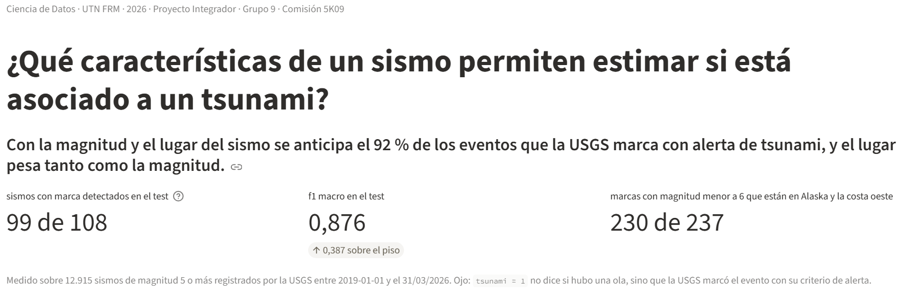
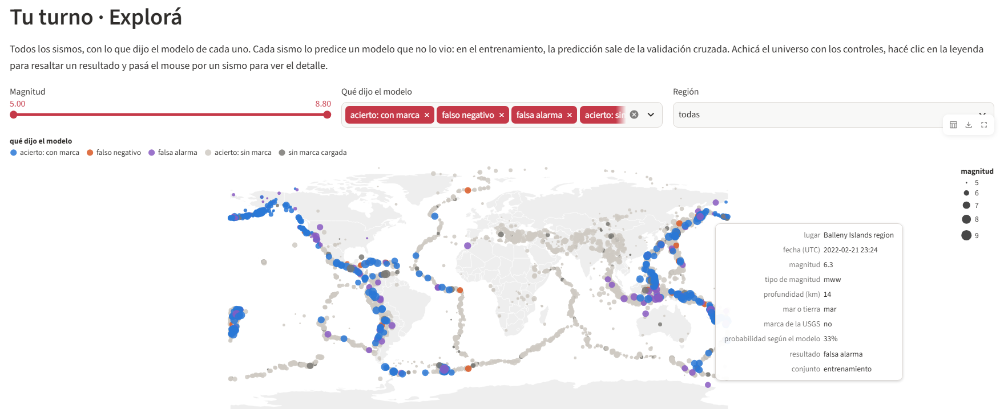
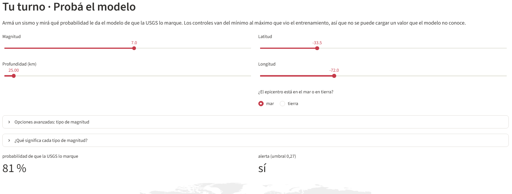
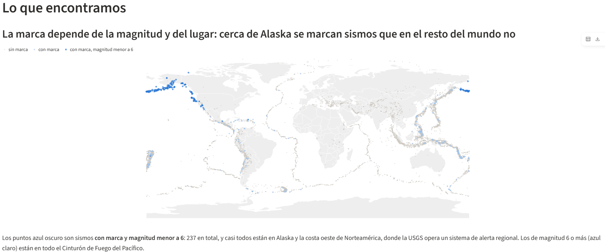
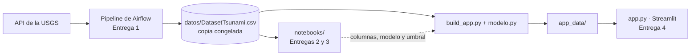

# ¿Qué sismos marca la USGS con alerta de tsunami?

Proyecto Integrador · Ciencia de Datos · UTN FRM · 2026 · Grupo 9 (Comisión 5K09)

**Pregunta:** ¿Qué características de un sismo permiten estimar si está asociado a un tsunami?

**Respuesta corta:** con la magnitud y el lugar del sismo se anticipa el 92 % de los eventos que la USGS marca con alerta de tsunami, y el lugar pesa tanto como la magnitud.

**Aplicación:** https://integradortsunamis-grupo09.streamlit.app/



> **Ojo con la etiqueta.** `tsunami = 1` no dice si hubo una ola: es la marca que pone la USGS cuando el evento cumple su criterio de alerta, que depende de la magnitud y de la región. Lo que el modelo aprende es **qué sismos marca la USGS**, una buena aproximación a «sismos con potencial de tsunami».

## La aplicación: una copa de martini

La app presenta los datos con la estructura de **copa de martini** (Segel y Heer, 2010). Primero guía al lector por un camino angosto y en orden, el tallo. Cuando ya entiende la historia, la visualización se abre y lo deja explorar por su cuenta, la copa. Así, antes de tocar un filtro, el lector ya sabe qué es la marca, dónde se concentra y cuánto acierta el modelo.

| Parte | Secciones de la app | Quién decide | Qué hace |
|---|---|---|---|
| Base | Portada | La app | Plantea la pregunta y da la respuesta corta con tres números |
| Tallo | Los datos · Lo que encontramos · El modelo | La app | Cuenta la historia en orden. Cada título afirma algo, un gráfico lo prueba y el desplegable «Cómo lo sabemos» tiene el detalle técnico |
| Copa | Explorá · Probá el modelo | El lector | Comprueba la historia con sus propios filtros y casos |

## Cómo usar la app

1. **Leé el tallo de arriba hacia abajo.** Los títulos solos cuentan la historia; si querés saber de dónde sale cada afirmación, abrí «Cómo lo sabemos».
2. **En «Explorá»**, cada punto del mapa es un sismo, coloreado según lo que dijo el modelo: acierto con marca, falso negativo, falsa alarma, acierto sin marca o sin marca cargada. Filtrá por magnitud, resultado o región, hacé clic en la leyenda para resaltar un resultado y pasá el mouse por un punto para ver su detalle. Cada sismo lo predice un modelo que no lo vio.

   

3. **En «Probá el modelo»**, armá un sismo con magnitud, profundidad, latitud, longitud y mar o tierra, y mirá qué probabilidad le da el modelo de que la USGS lo marque. Hay alerta si la probabilidad es 0,27 o más. El tipo de magnitud está en «Opciones avanzadas», y otro desplegable explica qué significa cada sigla.

   

**Casos para probar** (tipo de magnitud mww):

| Sismo | Magnitud | Profundidad | Latitud / Longitud | Mar o tierra | Probabilidad | Alerta |
|---|---|---|---|---|---|---|
| Chile (valores por defecto) | 7,0 | 25 km | −33,5 / −72,0 | mar | 81 % | sí |
| Islas Aleutianas, Alaska | 5,5 | 30 km | 52,0 / −170,0 | mar | 66 % | sí |
| El mismo, frente a Chile | 5,5 | 30 km | −33,5 / −72,0 | mar | 0,05 % | no |
| Japón | 6,5 | 30 km | 38,0 / 143,0 | mar | 36 % | sí |
| Japón, profundo | 6,5 | 400 km | 38,0 / 143,0 | mar | 23 % | no |

Las dos filas de magnitud 5,5 muestran el hallazgo central: el mismo sismo pasa de 66 % a casi 0 % con sólo cambiar el lugar.

## Resultados

### Lo que encontramos

- **La magnitud separa bien, pero no alcanza.** En el análisis exploratorio separó las clases en zona verde (1,38), pero el 21,7 % de los sismos de más de 7,5 no tiene la marca.
- **La otra mitad de la regla es el lugar.** 230 de las 237 marcas de magnitud menor a 6 están en Alaska y la costa oeste de Norteamérica, donde la USGS opera un sistema de alerta regional con un umbral más bajo.
- **La profundidad y la distancia a la costa casi no separan** (0,03 y 0,17; 0,42 si se miran sólo los sismos en el mar).



### El modelo

f1 macro en validación cruzada (media ± desvío), con validación por grupos de 2° × 2° y mes:

| Modelo | f1 macro |
|---|---|
| Piso (siempre «sin marca») | 0,489 ± 0,000 |
| Regresión logística | 0,747 ± 0,025 |
| Árbol de decisión | 0,842 ± 0,014 |
| Random forest | 0,872 ± 0,016 |
| Gradient boosting | 0,867 ± 0,016 |
| **Gradient boosting ajustado (el que usa la app)** | **0,881 ± 0,011** |

Random forest y gradient boosting empatan sin ajustar: la diferencia (0,005) es tres veces menor que el desvío (0,016), y también empatan en PR-AUC. Se eligió el boosting porque entrena unas tres veces más rápido y da un modelo más liviano para la app. Una vez ajustado con `GridSearchCV` supera a todos. El umbral 0,27 se eligió por validación cruzada: es el que más recall da sin perder f1, porque el error caro es no marcar un sismo con potencial de tsunami.

En el test, mirado una sola vez:

| Medida | Valor |
|---|---|
| f1 macro | 0,876 (validación cruzada: 0,888) |
| Recall de la clase tsunami | 0,917 (99 de 108 sismos con marca) |
| Precisión de la clase tsunami | 0,656 |
| PR-AUC | 0,804 (piso: 0,042) |
| Falsos negativos | 9 |
| Falsas alarmas | 52 (entre 2.475 sismos sin marca) |

### Conclusiones

- Lo que permite estimar si un sismo lleva la marca de tsunami es **su magnitud y su ubicación**, con un peso parecido: al desordenar cada columna en el test, el f1 cae 0,17 con la longitud, 0,16 con la magnitud y 0,15 con la latitud. El tipo de magnitud aporta algo (0,10); la profundidad y el mar o la tierra, nada.
- La regla tiene dos partes: un sismo de más de 6 casi siempre se marca, en cualquier lugar; uno moderado, casi sólo cerca de Alaska y la costa oeste.
- La ubicación no es fuga: las coordenadas existen apenas ocurre el sismo y no se calculan con la etiqueta. Pesan porque la regla de la USGS depende del lugar.
- El boosting le gana a la regresión logística porque puede dibujar la «caja» geográfica de Alaska; la logística sólo puede decir «más al norte, más marca».

## Límites

- **No predice olas**, predice la marca de la USGS. Donde la USGS casi no marca sismos (por ejemplo, el Caribe), el modelo tampoco.
- **Sólo sismos de magnitud 5 o más, de 2019 a marzo de 2026.** Los sismos desde el 01/04/2026 no se usan para entrenar porque la USGS todavía no les cargó la marca; en la app aparecen como «sin marca cargada».
- **Los grupos de validación son una aproximación:** una secuencia de réplicas que cruza un cambio de mes o el borde de una celda queda partida en dos grupos.

## Cómo encaja cada parte



| Carpeta o archivo | Qué es |
|---|---|
| `pipeline/sismos_tsunami_v2.py` | DAG de Airflow (Astro): extrae los sismos M ≥ 5 de la API de la USGS, los aplana, agrega `dist_costa_km`, valida y consolida en `sismos_master.csv`. Corre todos los días a las 02:00 |
| `notebooks/` | Entrega 2 (análisis exploratorio) y Entrega 3 (modelado) |
| `datos/DatasetTsunami.csv` | Copia congelada de la salida del pipeline, con 13.602 sismos del 01/01/2019 al 30/07/2026. Es la que usan el notebook de la Entrega 3 y la app |
| `modelo.py` | Las piezas del modelo (el transformador `EsOceanico`, el pipeline, la validación por grupos, la semilla y el umbral). Es el mismo código del notebook de la Entrega 3 |
| `build_app.py` | Toma el CSV, entrena el modelo elegido y calcula lo que muestra la app |
| `app_data/` | Lo que genera `build_app.py`: `sismos_app.csv`, `resumen.json` y `modelo.joblib` |
| `app.py` | La aplicación de Streamlit. Los gráficos están hechos con Altair |
| `docs/img/` | Las capturas de este README |

## Cómo se corre

Hace falta Python 3.12 o más nuevo.

```bash
python -m venv .venv
source .venv/Scripts/activate     # Git Bash en Windows
# .venv\Scripts\activate           # PowerShell o CMD
# source .venv/bin/activate        # Linux o Mac
pip install -r requirements.txt

python build_app.py               # genera app_data/ (tarda unos segundos)
streamlit run app.py              # abre la app en http://localhost:8501
```

`build_app.py` imprime los números del modelo. Tienen que coincidir con la tabla del test de arriba y con el notebook de la Entrega 3.

## Cómo se actualiza si cambian los datos

El pipeline agrega sismos nuevos todos los días a `sismos_master.csv`. Para regenerar la app con esos datos:

```bash
python build_app.py --datos ruta/a/sismos_master.csv
```

Después hay que subir la carpeta `app_data/` al repositorio, y Streamlit Community Cloud vuelve a publicar la app sola.

El corte de los datos está definido en `CORTE`, dentro de `modelo.py`. Cuando la USGS cargue las marcas desde abril de 2026, se puede mover `CORTE` y volver a correr el notebook y el script.

## Cómo se publica

1. Subir el repositorio a GitHub, con la carpeta `app_data/` incluida.
2. En [share.streamlit.io](https://share.streamlit.io), elegir **Create app**, este repositorio, la rama `main` y el archivo `app.py`.
3. En **Advanced settings**, elegir una versión de Python para la que exista scikit-learn 1.9.1.

El modelo guardado sólo se carga con esa misma versión de scikit-learn.

## Integrantes

Grupo 9 · Comisión 5K09 · Ciencia de Datos · Ingeniería en Sistemas de Información · UTN Facultad Regional Mendoza

- Facundo Bengoa
- Facundo Costella
- Diego Daza
- Lucas García
- Juan Manuel Sosa
- Porteros Yadhira
